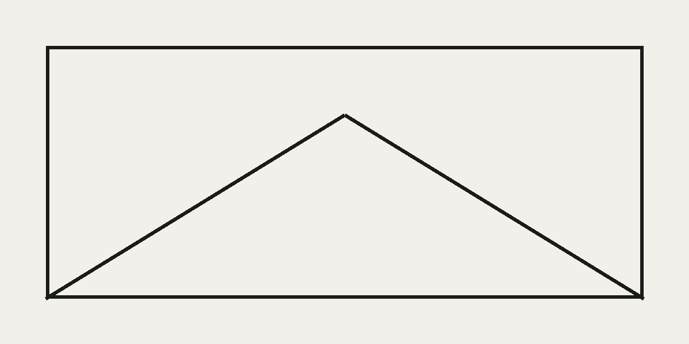

A paragraph with a [link](https://example.com), _emphasis_, **strong text** and `inline code`.



## Second-level heading

### Third-level heading

> A quotation, set apart from the surrounding text.

- First item
- Second item, long enough to wrap onto another line on narrow screens to check list indentation
- Third item

1. Ordered item
2. Another ordered item

```js
const greeting = 'hello';
console.log(greeting);
```

| Column | Value |
| ------ | ----- |
| One    | 1     |
| Two    | 2     |

---

A closing paragraph after a rule.
